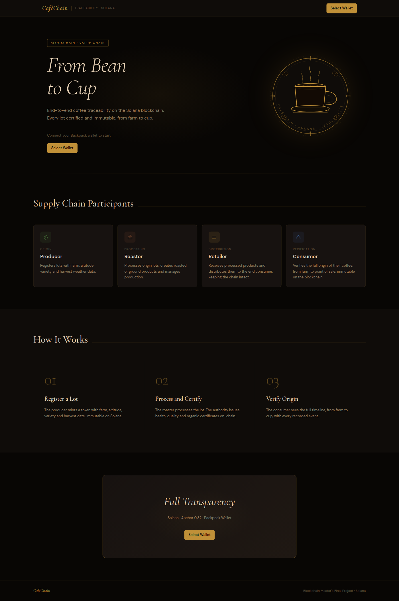
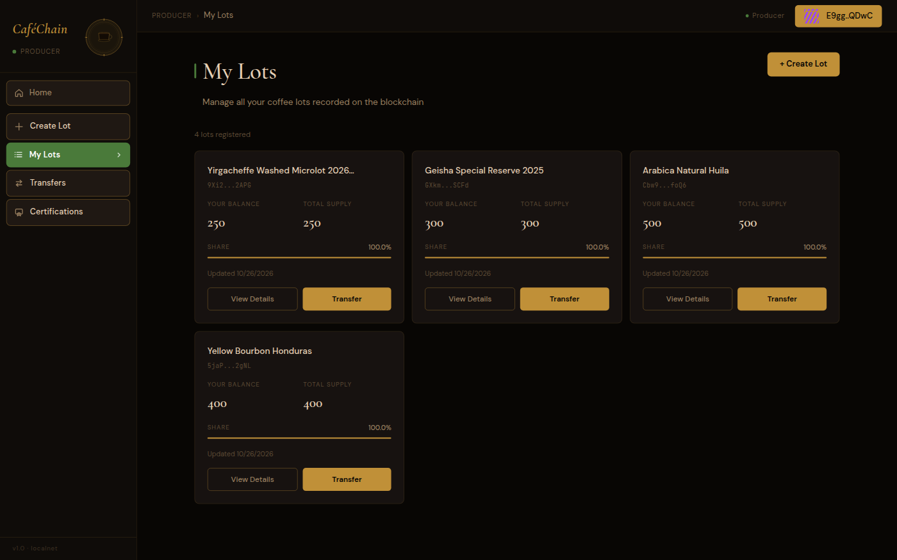
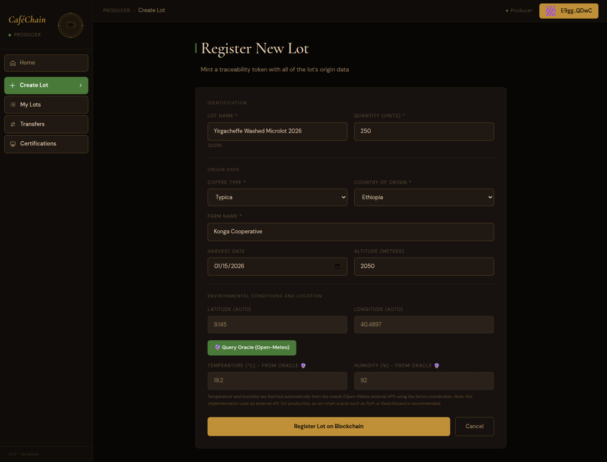
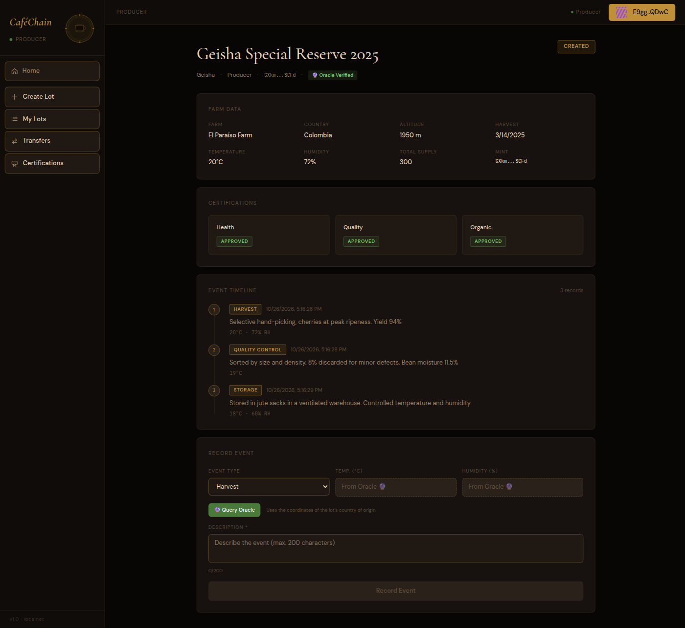
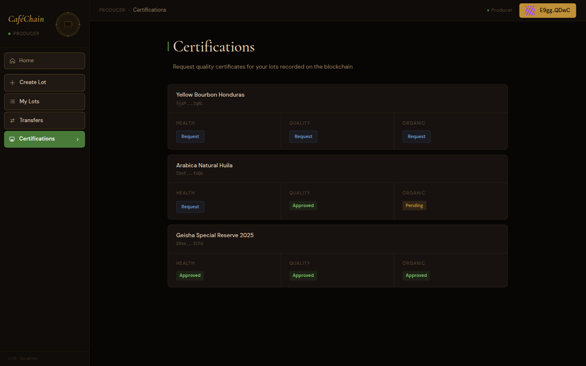
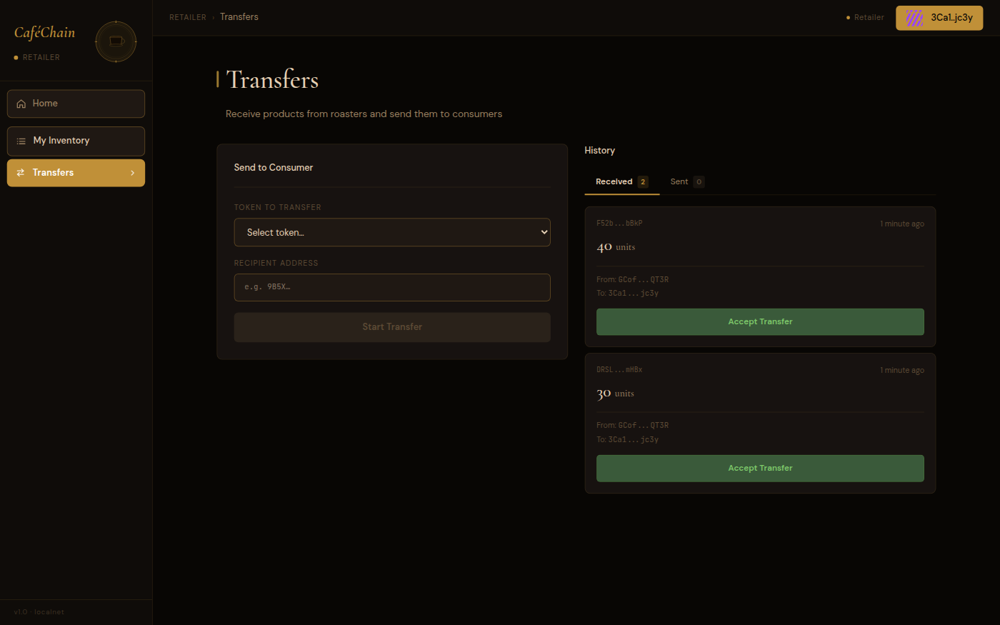

# CaféChain — Coffee Traceability on Solana

Final project of the CodeCrypto Master's Degree in Blockchain and AI Systems Engineering: an Anchor program and a Next.js frontend, running on Solana localnet and Devnet.

CaféChain records coffee lots from the farm to the consumer. Every transfer, traceability event and certificate is written on-chain, where it cannot be altered.

---

## Contents

- [Author](#author)
- [License](#license)
- [Use of AI Tools](#use-of-ai-tools)
- [Problem](#problem)
- [Tech Stack](#tech-stack)
- [Architecture](#architecture)
- [Program on Devnet](#program-on-devnet)
- [Switching Between Localnet and Devnet](#switching-between-localnet-and-devnet)
- [Running Locally](#running-locally)
- [Role Setup — Step by Step](#role-setup--step-by-step)
- [Full Demo — From Bean to Cup](#full-demo--from-bean-to-cup)
- [Certifications](#certifications)
- [Oracle Integration (Open-Meteo)](#oracle-integration-open-meteo)
- [MCP Server (Model Context Protocol)](#mcp-server-model-context-protocol)
- [Backpack Wallet on Localnet](#backpack-wallet-on-localnet)
- [Screenshots](#screenshots)
- [Technical Diagrams](#technical-diagrams)
- [Additions to the Course Starter Project](#additions-to-the-course-starter-project)
- [Notes](#notes)

---

## Author

- **Name:** Javier Fernandez
- **LinkedIn:** [linkedin.com/in/javier-fernandez-web3](https://www.linkedin.com/in/javier-fernandez-web3)
- **GitHub:** [github.com/javierfer](https://github.com/javierfer)

---

## License

MIT License — see [`LICENSE`](./LICENSE)

---

## Use of AI Tools

### OpenCode (85%)
Main development: features, debugging, documentation and refactoring. Used together with the project's own MCP server to query on-chain state during development.

### Claude (10%)
Code review, architecture suggestions and refactoring of Anchor instructions.

### ChatGPT (5%)
One-off questions and first examples.

### Understanding
I reviewed, understood and adapted all generated code. The implementation follows Solana/Anchor best practices and is covered by 18 automated tests.

---

## Problem

The coffee supply chain lacks transparency. End consumers cannot verify where a product really comes from, how it was grown, or how it moved between the actors in the chain (producer, roaster, retailer). Records live on paper or in centralized databases, which are easy to alter.

CaféChain records every lot, transfer, traceability event and certificate directly on Solana, where they are immutable and publicly verifiable. Anyone in the chain, from producer to consumer, can read the full history of a lot without relying on a central intermediary.

---

## Tech Stack

| Layer | Technology |
|-------|-----------|
| Blockchain | Solana localnet (`solana-test-validator`) and Devnet |
| On-chain program | Rust + Anchor 0.32.1 |
| Frontend | Next.js + Tailwind CSS |
| Wallet | Backpack / any wallet-adapter wallet |
| Tests | Anchor/Mocha (TypeScript) |

---

## Architecture

### On-chain role flow

```
Authority
   │  initialize()
   │  validate_role() ──────────────────────────┐
   │                                            │
Producer ──create_token()──► [TraceToken]       │
   │         (coffee data)    source_tokens=[]  │
   │                                            │
   │  initiate_transfer()                       │ validated roles
   │  accept_transfer()                         │
   ▼                                            │
Factory ──create_token()──► [TraceToken]        │
   │         (processed)     source_tokens=[P]  │
   │                                            │
   │  initiate_transfer()                       │
   │  accept_transfer()                         │
   ▼                                            │
Retailer                                        │
   │  initiate_transfer()                       │
   │  accept_transfer()                         │
   ▼                                            │
Consumer ◄──────────────────────────────────────┘
```

Valid transfer paths: `Producer→Factory`, `Factory→Retailer`, `Retailer→Consumer`.
The program rejects any other path with `InvalidTransferPath`.

In the UI the Factory role is labelled **Roaster**.

### On-chain accounts (PDAs)

| Account | Seeds | Description |
|--------|-------|-------------|
| `ProgramConfig` | `["config"]` | Program authority |
| `RoleRegistry` | `["role_registry", wallet]` | A user's validated role |
| `PendingRoleRegistration` | `["pending_role", wallet]` | Pending role request |
| `TraceToken` | `["trace_token", mint]` | Lot with coffee and traceability data |
| `TokenBalance` | `["token_balance", mint, owner]` | A lot's balance per owner |
| `PendingTransfer` | `["pending_transfer", mint, from, to]` | Transfer held in escrow |
| `TraceEvent` | `["trace_event", mint, index_le32]` | Traceability event of a lot |
| `Certificate` | `["certificate", mint, cert_type_u8]` | Health / quality / organic certificate |

### Instructions

| Instruction | Who | What it does |
|-------------|-------|---------|
| `initialize` | Authority | Initializes `ProgramConfig` |
| `register_role` | Anyone | Requests a role |
| `validate_role` | Authority | Approves the request |
| `create_token` | Producer / Factory | Creates a lot with coffee data |
| `initiate_transfer` | Balance holder | Opens a transfer in escrow |
| `accept_transfer` | Recipient | Accepts and moves the balance |
| `add_trace_event` | Balance holder | Adds an event to the timeline |
| `request_certificate` | Balance holder (Producer / Factory in the UI) | Requests a certificate from the authority |
| `resolve_certificate` | Authority | Approves or rejects the certificate |

---

## Program on Devnet

| | |
|---|---|
| **Network** | Solana Devnet |
| **Program ID** | `f5HoQ1phkhNxGkWZbkttQF334ZHpN2PRL7RaqSoesDX` |
| **Solscan** | [View on Solscan](https://solscan.io/account/f5HoQ1phkhNxGkWZbkttQF334ZHpN2PRL7RaqSoesDX?cluster=devnet) |
| **Solana Explorer** | [View on Explorer](https://explorer.solana.com/address/f5HoQ1phkhNxGkWZbkttQF334ZHpN2PRL7RaqSoesDX?cluster=devnet) |

---

## Switching Between Localnet and Devnet

The repository is configured for **Devnet**. Two files select the cluster:

| File | Localnet | Devnet |
|---------|----------|--------|
| `traza/Anchor.toml` | `[programs.localnet]` · `cluster = "localnet"` | `[programs.devnet]` · `cluster = "devnet"` |
| `web/lib/solana/constants.ts` | `CLUSTER = "localnet"` · `RPC_ENDPOINT = "http://localhost:8899"` | `CLUSTER = "devnet"` · `RPC_ENDPOINT = "https://api.devnet.solana.com"` |

Anchor commands also accept `--provider.cluster localnet`, which overrides `Anchor.toml` for one command.

---

## Running Locally

You need `solana-cli`, `anchor-cli 0.32.x`, `node 18+` and `yarn`.

### 1. Local validator

```bash
solana-test-validator --reset
```

Leave it running in its own terminal for the whole session.

### 2. Point the Solana CLI at localnet

```bash
solana config set --url localhost
```

### 3. Build and deploy the program

```bash
cd traza
yarn install
anchor build
anchor keys sync      # first build only: see below
anchor build
anchor deploy --provider.cluster localnet
```

The deployed program ID `f5HoQ…` belongs to the author's program keypair, which is not in the repository. Your first `anchor build` creates a new keypair in `target/deploy/`; `anchor keys sync` writes its address into `lib.rs` and `Anchor.toml`. Then put the same address in:

- `web/lib/solana/constants.ts` (`PROGRAM_ID`)
- `traza/scripts/seed.ts` and `mcp-server/src/index.ts` (`PROGRAM_ID`)
- the IDLs: `cp target/idl/traza.json ../web/types/ && cp target/types/traza.ts ../web/types/ && cp target/idl/traza.json ../mcp-server/src/idl/`

### 4. Run the tests

```bash
anchor test --provider.cluster localnet --skip-local-validator
```

Expected result: **18 passing**.

### 5. Load demo data (optional)

The seed script uses the authority keypair at `~/.config/solana/id.json` and one keypair per role in `roles/` (git-ignored). Create the role keypairs once, from the repository root:

```bash
mkdir -p roles
for r in producer factory retailer consumer; do
  solana-keygen new --no-bip39-passphrase --silent --outfile roles/wallet-$r.json
done
```

Then load roles, lots and events in one command:

```bash
cd traza
yarn seed
```

| Role | Data loaded |
|-----|---------------|
| Producer | 3 lots with 3 events each (harvest, processing, quality check, storage, transport) |
| Factory | 2 processed products with 4 events each (drying, roasting, cupping, packaging) |
| Retailer | 249 units of *Intense Dark Roast 250g* with receiving and inspection events |
| Consumer | 1 unit with full traceability, visible from the product detail page |

Certificates loaded:

| Token | Health | Quality | Organic |
|-------|-----------|---------|---------|
| Geisha Special Reserve 2025 | ✅ Approved | ✅ Approved | ✅ Approved |
| Arabica Natural Huila | — | ✅ Approved | — |
| Yellow Bourbon Honduras | — | — | — |
| Intense Dark Roast 250g | — | ✅ Approved | — |
| Single Origin Geisha Espresso | — | ✅ Approved | — |

Import each `roles/wallet-*.json` into Backpack (Import Wallet → Private Key, paste the file's JSON array) to use the app as each role.

The script is **idempotent**: if the program is already initialized or a role already exists, it skips that step.

### 6. Frontend

```bash
cd web
npm install   # first time only
npm run dev
```

Open `http://localhost:3000`.

---

## Role Setup — Step by Step

Follow this order the first time. Each step needs the wallet it names.

### Step 1 — Authority: initialize

1. Connect the authority wallet (`~/.config/solana/id.json`)
2. Dashboard → **Initialize** → confirm the transaction
3. The program is ready to register roles

### Step 2 — Register roles (one wallet per role)

For each wallet (Producer, Roaster, Retailer, Consumer):

1. Connect the wallet
2. Landing page → **Open Dashboard** (a wallet without a role is sent to role registration) → choose the role → confirm
3. The request stays pending

### Step 3 — Authority: validate roles

1. Switch back to the authority wallet
2. Dashboard → **Validate Roles**
3. Approve each pending request
4. The roles are now active on-chain

---

## Full Demo — From Bean to Cup

### A. Producer creates a lot

1. Connect the Producer wallet
2. Dashboard → **Create Lot**
3. Fill in the data:
   - Name: `Organic Coffee Lot 001`
   - Type: Arabica · Farm: La Esperanza · Country: Colombia
   - Altitude: 1800 m · Harvest: (today)
4. Confirm → the lot appears under **My Lots**

### B. Producer records a harvest event

1. In **My Lots** → **View Details** on the new lot
2. "Record Event" section → Type: Harvest
3. Description: `Hand harvest completed` · Query the oracle for temperature and humidity
4. Confirm → the event appears in the timeline

### C. Producer transfers to the Roaster

1. In **My Lots** → **Transfer** → enter the Roaster's address and the amount
2. Confirm the transaction (the lot goes into escrow)

### D. Roaster accepts and creates a processed product

1. Connect the Roaster wallet
2. Dashboard → **Transfers** → accept the Producer's transfer
3. Dashboard → **Create Product**
4. Select the Producer's lot as the source
5. Name: `Premium Roasted Coffee` · Type: Medium Roast
6. Confirm → the product is linked to its source lot

### E. Roaster transfers to the Retailer

1. In **My Products** → **Transfer** → enter the Retailer's address

### F. Retailer accepts and transfers to the Consumer

1. Connect the Retailer wallet → accept the transfer
2. In **My Inventory** → **Transfer** → enter the Consumer's address

### G. Consumer verifies the origin

1. Connect the Consumer wallet → accept the transfer
2. In **My Products** → **View Details**
3. Check the farm data, event timeline and chain of transfers

---

## Certifications

### Producer requests a certificate

1. Dashboard → **Certifications**
2. Select the lot → **Request** the type you need (Health / Quality / Organic)
3. Add notes → confirm the transaction
4. The certificate shows as **Pending** (yellow)

### Authority approves or rejects

1. Connect the authority wallet
2. Dashboard → **Certifications**
3. The list shows every pending request for every lot
4. Write the resolution notes → **Approve** or **Reject**
5. The status updates on the Producer's side (green ✅ / red ❌)

---

## Oracle Integration (Open-Meteo)

### What it does

Temperature and humidity come from an external data source (the Open-Meteo API) instead of being typed in by the Producer.

### How it works

1. **Create Lot (Producer)**:
   - Selecting the **Country of Origin** fills in the coordinates (lat/lon)
   - The Producer clicks **"🔮 Query Oracle"** to fetch live weather data
   - Temperature and humidity become **read-only** (dashed style)
   - They are stored on-chain with `oracle_verified = true`

2. **Record Event (Producer only)**:
   - Same flow: queries the oracle with the lot's coordinates
   - Temperature and humidity are verified externally

### Coverage by country

| Country | Latitude | Longitude |
|---------|----------|-----------|
| Colombia | 4.5709 | -74.2973 |
| Ethiopia | 9.1450 | 40.4897 |
| Brazil | -14.2350 | -51.9253 |
| Honduras | 15.2000 | -86.2419 |
| Guatemala | 15.7835 | -90.2308 |
| Mexico | 23.6345 | -102.5528 |
| Peru | -9.1900 | -75.0152 |
| Indonesia | -0.7893 | 113.9213 |
| Kenya | -0.0236 | 37.9062 |
| Vietnam | 14.0583 | 108.2772 |

### Oracle API

The `/api/oracle/weather` endpoint queries Open-Meteo:

```bash
GET /api/oracle/weather?lat=4.5709&lon=-74.2973
```

Response:
```json
{
  "temperature": 22.5,
  "humidity": 65,
  "source": "Open-Meteo Oracle",
  "timestamp": "2026-04-18T12:00:00.000Z"
}
```

### Technical note

This implementation uses an **external API** (Open-Meteo) as an off-chain oracle. For production, an on-chain oracle such as **Pyth Network** or **Switchboard** would be more secure and decentralized.

---

## MCP Server (Model Context Protocol)

The project includes an MCP server that exposes the Traza program's on-chain state as tools any compatible AI agent can call.

### Tools

| Tool | Description |
|-------------|-------------|
| `get_balance` | SOL balance of any wallet |
| `get_program_config` | Program authority and initialization status |
| `get_role_registry` | Validated role of a given wallet |
| `list_roles` | All validated roles (Producer/Factory/Retailer/Consumer) |
| `list_pending_roles` | Role requests awaiting approval |
| `list_trace_tokens` | All coffee lots recorded on-chain |
| `get_trace_token` | One lot by mint address |
| `get_trace_events` | Traceability event history of a lot (harvest, transport…) |
| `get_token_balance` | Units of a lot held by a wallet |
| `list_certificates` | Health/quality/organic certificates, filterable by mint |
| `list_pending_transfers` | Transfers in escrow awaiting acceptance |

The `SOLANA_RPC` environment variable selects the cluster (default `http://localhost:8899`).

### Install

```bash
cd mcp-server
npm install
npm run build
```

### Add the server to Claude Code (CLI)

```bash
claude mcp add traza-solana-server node /absolute/path/to/project/mcp-server/dist/index.js
```

To point it at Devnet instead of localnet:

```bash
claude mcp add traza-solana-server \
  -e SOLANA_RPC=https://api.devnet.solana.com \
  node /absolute/path/to/project/mcp-server/dist/index.js
```

Check that it is registered:

```bash
claude mcp list
```

### Add the server to OpenCode

Edit the OpenCode config file (`~/.config/opencode/opencode.json`) and add an `mcp` section:

```json
{
  "$schema": "https://opencode.ai/config.json",
  "mcp": {
    "traza": {
      "type": "local",
      "command": ["sh", "-c", "cd /absolute/path/to/project/mcp-server && npx -y tsx src/index.ts"],
      "environment": {
        "SOLANA_RPC": "http://localhost:8899"
      },
      "enabled": true,
      "timeout": 60000
    }
  }
}
```

Restart OpenCode to load the new server.

### Using it from the assistant

Once registered, the assistant can answer questions such as:

- *"Which coffee lots are recorded on-chain?"*
- *"What is the event history of the lot with mint `ABC…`?"*
- *"Which roles are validated in the program?"*
- *"Does lot `XYZ…` have approved certificates?"*

---

## Backpack Wallet on Localnet

1. Open Backpack → Settings → Networks → **Add Network**
2. Name: `Localnet` · RPC: `http://localhost:8899` · WebSocket: `ws://localhost:8900`
   > **Note:** if the wallet cannot reach `localhost`, expose the validator through a tunnel. [ngrok](https://ngrok.com/) is one option: `ngrok http 8899` gives you a public URL to use as the RPC instead of `localhost`.
3. Switch to the Localnet network
4. To import an existing keypair:
   ```bash
   cat ~/.config/solana/id.json   # prints the byte array
   ```
   In Backpack: Import Wallet → Private Key (paste the JSON array)

For the role wallets (Producer, Roaster, Retailer, Consumer), use the keypairs in `roles/` from [step 5](#5-load-demo-data-optional), or create and fund new ones:

```bash
solana-keygen new --outfile roles/wallet-producer.json
solana airdrop 2 $(solana-keygen pubkey roles/wallet-producer.json)
```

Import each one into Backpack under a different name.

---

## Screenshots

| | | |
|---|---|---|
| [](./screenshots/01-landing-page.png) | [](./screenshots/09-producer-dashboard-lots.png) | [](./screenshots/03-create-lot-form.png) |
| Landing page | Producer dashboard with lots | Create-lot form with oracle |
| [](./screenshots/10-lot-detail-timeline.png) | [](./screenshots/11-lot-detail-certificates.png) | [](./screenshots/13-transfers-history.png) |
| On-chain event timeline | Certificates per lot | Transfers in escrow |

See every screenshot in [`/screenshots`](./screenshots/)

---

## Technical Diagrams

See [`/docs/diagrams.md`](./docs/diagrams.md)

| Diagram | Description |
|----------|-------------|
| [System architecture](./docs/diagrams.md#1-system-architecture) | Frontend · Backend · Blockchain · MCP |
| [Roles and traceability flow](./docs/diagrams.md#2-roles-and-traceability-flow) | Producer → Factory → Retailer → Consumer |
| [create_token sequence with oracle](./docs/diagrams.md#3-registering-a-lot-create_token) | Full flow with Open-Meteo |
| [Escrow transfer](./docs/diagrams.md#4-transfer-flow-escrow) | initiate_transfer / accept_transfer |
| [Certifications](./docs/diagrams.md#5-certification-flow) | request_certificate / resolve_certificate |
| [On-chain data model](./docs/diagrams.md#6-on-chain-data-model) | Every PDA and how they relate |
| [MCP integration with AI](./docs/diagrams.md#7-mcp-integration--ai-queries) | OpenCode / Claude querying the blockchain |

---

## Additions to the Course Starter Project

The project started from the course's traceability starter (roles, tokens and escrow transfers). I added:

| Addition | Description |
|-----------|-------------|
| **On-chain certifications** | Full request and resolution flow for Health / Quality / Organic certificates, with one PDA per lot and type |
| **Open-Meteo oracle** | Temperature and humidity fetched from an external API when creating lots and events; stored with an immutable `oracle_verified = true` flag |
| **Automatic coordinates by country** | Choosing the country of origin fills in lat/lon and makes the fields read-only |
| **MCP server** | 11 MCP tools that expose on-chain state to any AI agent (OpenCode, Claude) in natural language |
| **18 Anchor tests** | Cover the full cycle: roles, tokens, events, certifications, transfers and error cases |
| **Idempotent seed script** | `yarn seed` loads complete demo data (5 lots, events, certificates, 4 roles) without breaking existing state |
| **Transfer path validation** | The Rust program rejects any invalid path (e.g. Producer→Consumer) with `InvalidTransferPath` |
| **Factory with source tokens** | The Factory must reference the Producer's source lots via `remaining_accounts`, so raw-material lineage is immutable |

---

## Notes

| Note | Description |
|------|-------------|
| Off-chain oracle | Uses the Open-Meteo API, not an on-chain oracle (Pyth/Switchboard) |
| Authority as certifier | There is no separate `Certifier` role; the authority approves every certificate |
| No NFT mint | Lots are program tokens with supply > 1, not standard SPL NFTs (which need supply = 1) |
| One certificate per type per lot | A certificate type cannot be requested again for the same lot (the PDA is unique) |
| Validator port conflict | `solana-test-validator` uses port 8000 for gossip. If another service holds it, start the validator with `--gossip-port 18000 --dynamic-port-range 18001-18030` |
