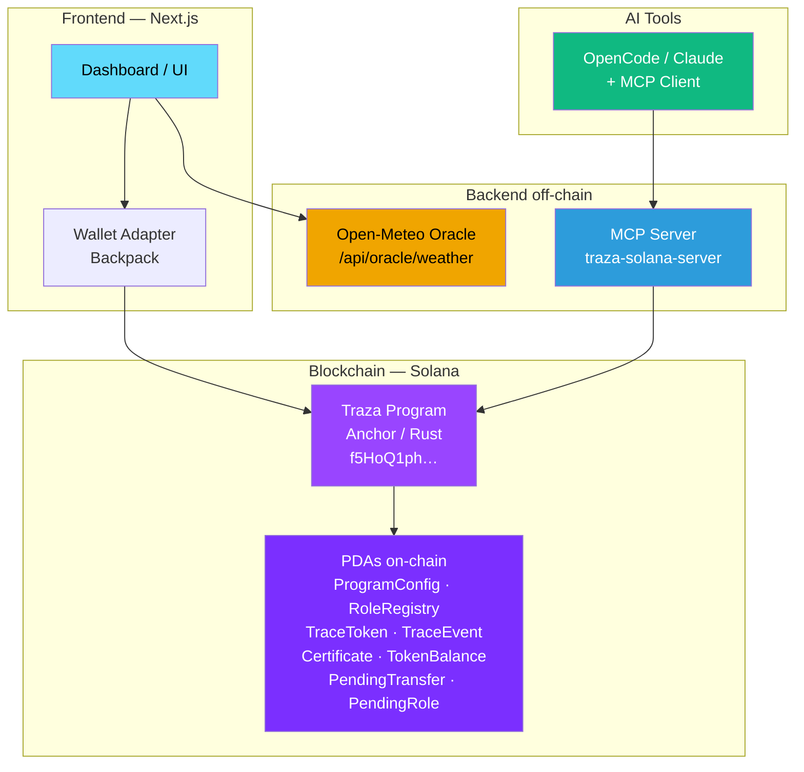
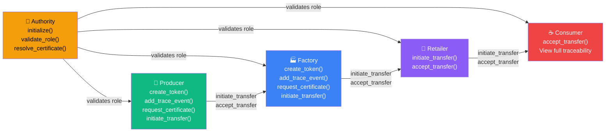
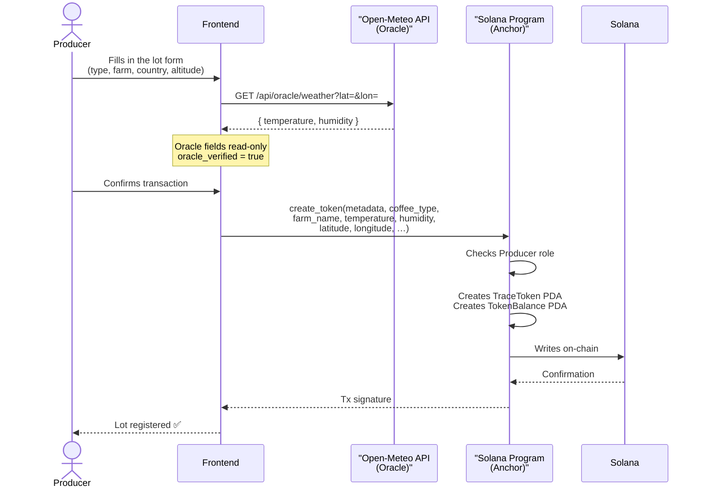
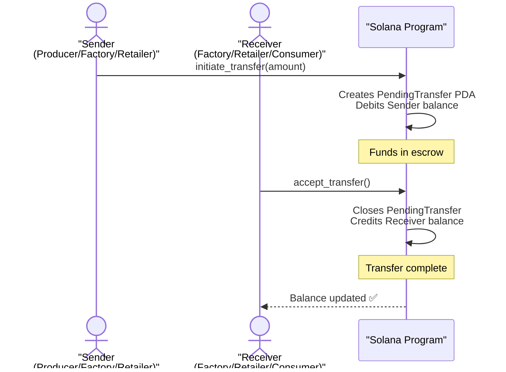
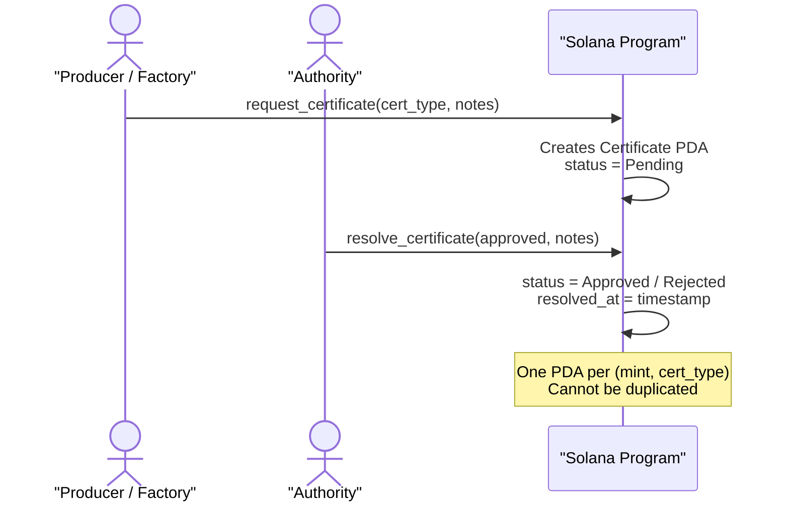
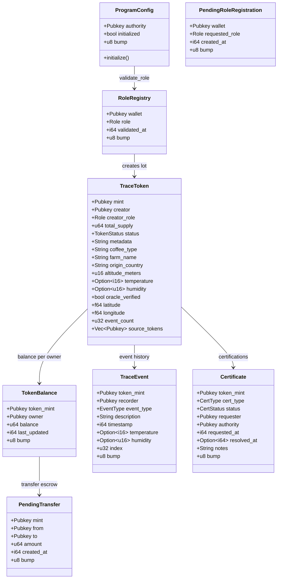
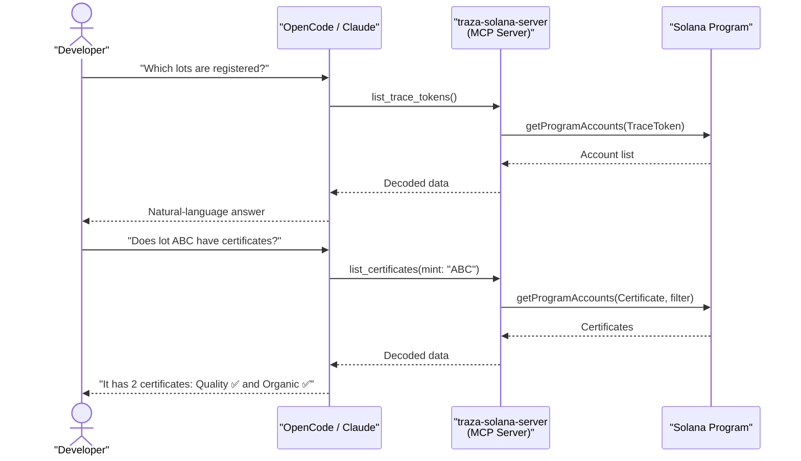

# Technical Diagrams — CaféChain

## 1. System Architecture

---

## 2. Roles and Traceability Flow

---

## 3. Registering a Lot (create_token)

---

## 4. Transfer Flow (escrow)

---

## 5. Certification Flow

---

## 6. On-Chain Data Model

---

## 7. MCP Integration — AI Queries

